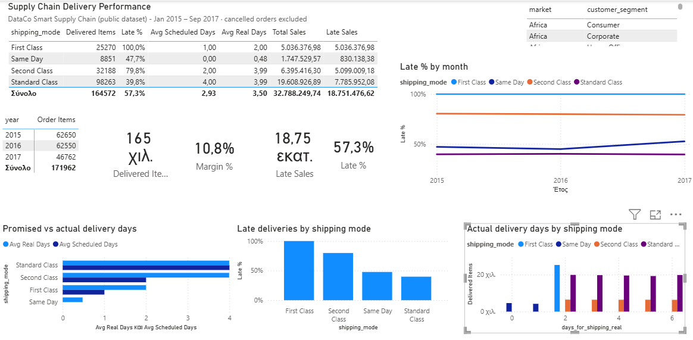

# Supply Chain Delivery Performance (Python pipeline + SQL + Power BI)

Which orders arrive late, why, and how much revenue is affected? An end-to-end analytics project on a public supply-chain dataset: data profiling, cleaning and automated data-quality checks in Python, a star-schema data model in SQLite, SQL analysis, and a Power BI dashboard.



## Business questions

1. What share of deliveries is late, and does it depend on the shipping mode?
2. Is the problem slow transport or unrealistic delivery promises?
3. How much revenue is linked to late deliveries?
4. Can the data be trusted, and what are its limits?

## Data

[DataCo Smart Supply Chain for Big Data Analysis](https://data.mendeley.com/datasets/8gx2fvg2k6/5) (Kaggle / Mendeley Data, CC BY 4.0).

- 180,519 order lines (1 row = 1 product in an order), 65,752 orders, 53 columns.
- Orders from 01/2015 to 01/2018.
- The raw data is not stored in this repository. To rebuild everything, download `DataCoSupplyChainDataset.csv` into `data-raw/` and run the notebooks in order.

## Method

1. **Profiling (`01_profiling.ipynb`).** Shape, types, missing values, duplicates, category counts and date range.
2. **Cleaning and data-quality checks (`02_cleaning_quality.ipynb`).**
   - Removed personal data (customer name, email, password, street) and empty or unused columns. Converted dates and standardised column names to `snake_case`.
   - Added `delay_days`, `is_cancelled`, `is_late` and `in_analysis_period`.
   - 9 automated PASS/FAIL checks: unique key, no nulls in key columns, late flag consistent with delivery days, cancelled orders, date order, delivery days = shipping date − order date, quantity > 0, sales = price × quantity. All 9 pass.
3. **Star schema (`03_star_schema.ipynb`).**
   - `fact_order_items` (180,519 rows) with `dim_customer` (20,652), `dim_product` (118), `dim_location` (3,772, surrogate key), `dim_shipping_mode` (4) and `dim_date` (1,133 days).
   - 9 referential-integrity checks, all pass. Written to SQLite and to CSV for Power BI.
4. **SQL analysis (`sql/`).** Late rate per shipping mode, the same per year, the distribution of actual delivery days, and sales and margin for late vs on-time deliveries.
5. **Power BI.**
   - Star-schema model with one-to-many relationships. The order-date relationship is active; the shipping-date relationship is an inactive role-playing date.
   - DAX measures (Late %, Avg Scheduled/Real Days, Total Sales, Late Sales, Margin %) and a page filter for the analysis period.
6. **Reconciliation.** Power BI totals match the SQL results exactly: 164,572 delivered order items, Late % 57.3%, sales 32.79M, late sales 18.75M.

## Data issues found and how they were handled

| Issue | Evidence | Decision |
|---|---|---|
| `late_delivery_risk` disagreed with delivery days | All 4,423 differing rows were cancelled orders, which always have risk = 0 | Cancelled orders (7,754 lines: CANCELED + SUSPECTED_FRAUD) are excluded from delivery KPIs; the rule is a coded check |
| Recording changes from 10/2017 | Lines per month drop from ~5,200 to ~2,100; 1 product per order; 8–20 products instead of 42–53 | Trends analysed for 01/2015 – 09/2017 (33 full months); data kept and flagged |
| Markets differ by year | e.g. USCA has 25,681 lines in 2016 and 118 in 2017; LATAM has none in 2016 | Main analysis by shipping mode, which is stable in every year; market comparisons treated as limited |

## Key findings (01/2015 – 09/2017, cancelled orders excluded)

| Shipping mode | Order items | Promised days | Actual days (avg) | Late % | Late sales |
|---|---|---|---|---|---|
| First Class | 25,270 | 1 | 2.00 | 100.0% | 5.04M |
| Second Class | 32,188 | 2 | 3.99 | 79.8% | 5.10M |
| Same Day | 8,851 | 0 | 0.48 | 47.7% | 0.83M |
| Standard Class | 98,263 | 4 | 3.99 | 39.8% | 7.79M |

- **57.3% of delivered order items are late**, linked to **18.75M of 32.79M sales (57.2%)**.
- **The promise is the problem, not the transport.**
  - First Class promises 1 day and always takes 2, so every First Class order (5.04M of sales) is late.
  - Second Class and Standard Class take the same time: 2–6 days, average 3.99. Second Class promises 2 days and Standard promises 4.
  - That alone explains 80% vs 40% late (4 of 5 vs 2 of 5 possible delivery days).
- **The pattern is stable every year.** First Class 100% in 2015, 2016 and 2017; Second Class 79.2–80.3%; Standard Class 39.5–40.1%.
- **Margin.** Late deliveries show a slightly lower profit margin than on-time ones (Standard 10.4% vs 11.0%, Second 10.3% vs 11.6%, Same Day 9.4% vs 11.1%). The difference is small and was not tested statistically.

**Recommendation:** align the promised delivery days with what the network actually achieves (First Class 2 days; Second Class no faster than Standard), or invest in faster transport for the premium modes. Then track Late % monthly against the new promises.

## Limitations

- The actual delivery days are spread almost perfectly evenly over 2–6 days, identically for two shipping modes. This suggests the dataset is partly simulated. The analysis shows the method, not real company results.
- Market comparisons are confounded with time, because markets appear in different years.
- Margin differences are descriptive only (correlation is not causation, and no significance test was run).
- Data after 09/2017 is excluded from trends because its structure changes.

## SQL queries

| File | What it answers |
|---|---|
| `sql/01_delivery_by_shipping_mode.sql` | Late %, promised and actual days per shipping mode |
| `sql/02_shipping_mode_by_year.sql` | Whether the result holds in every year |
| `sql/03_real_days_distribution.sql` | Distribution of actual delivery days |
| `sql/04_late_sales_impact.sql` | Sales on late deliveries and margin late vs on time |

## Repository structure

```
supply-chain-delivery-performance/
├── README.md
├── dashboard.png
├── supply_chain_delivery.pbix
├── 01_profiling.ipynb
├── 02_cleaning_quality.ipynb
├── 03_star_schema.ipynb
└── sql/
    ├── 01_delivery_by_shipping_mode.sql
    ├── 02_shipping_mode_by_year.sql
    ├── 03_real_days_distribution.sql
    └── 04_late_sales_impact.sql
```

## Tools

Python (pandas, Jupyter) · SQL (SQLite, DBeaver) · Power BI (Power Query, DAX, data modeling)
